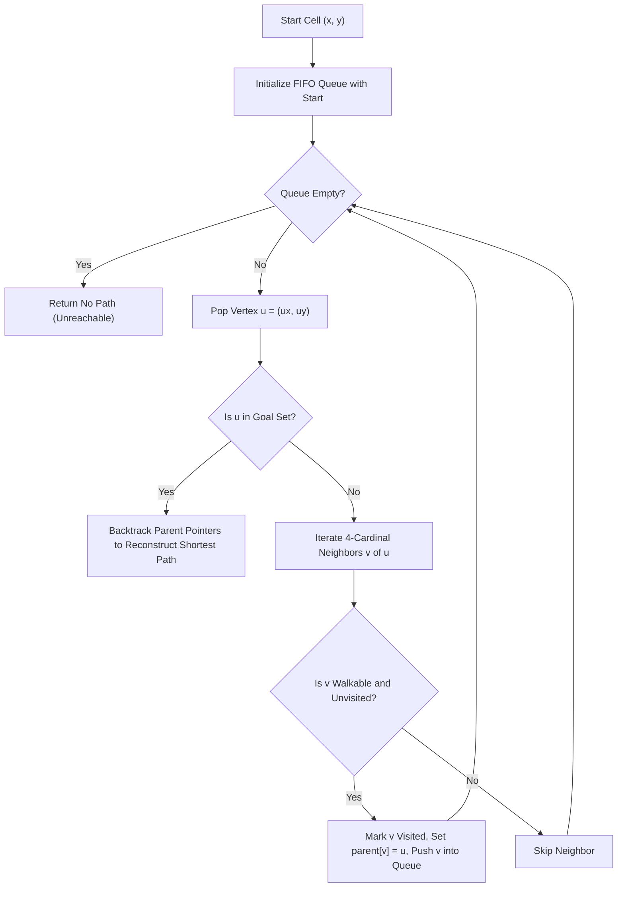
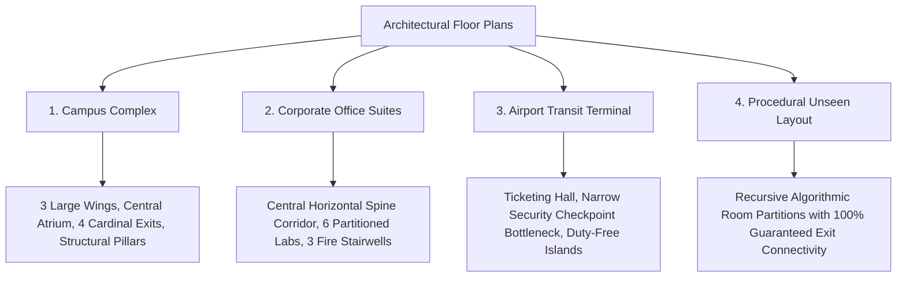

# RACE: Comprehensive Technical & Algorithmic Reference Manual
## Mathematical Models, Graph Theory, Physics Engines, and Implementation Mechanics

---

### Document Overview
This document provides an exhaustive, mathematically rigorous, and code-level technical explanation of every concept, algorithm, formula, and engineering decision implemented in the **RACE (Robust & Adaptive Crowd Evacuation)** simulation system. It is designed specifically for academic evaluations, thesis documentation, and project viva defenses.

---

# Table of Contents
1. [Mathematical Physics & Computational Mechanics](#1-mathematical-physics--computational-mechanics)
   - 1.1 Discrete Cellular Automata vs. Continuous 2D Vector Dynamics
   - 1.2 Newton-Euler Continuous Mechanics
   - 1.3 Helbing's Social Force Model (SFM) Formulation
   - 1.4 Desired Driving Force ($\vec{f}_i^0$) & Relaxation Time ($\tau$)
   - 1.5 Interpersonal Repulsion Force ($\vec{f}_{ij}$) & Contact Mechanics
   - 1.6 Boundary Wall & Architectural Obstacle Repulsion ($\vec{f}_{iw}$)
   - 1.7 Social Group Dynamics & Companion Cohesion Force ($\vec{f}_i^{\text{group}}$)
   - 1.8 Numerical Integration: Explicit Euler Scheme & Step-Size Stability ($\Delta t$)
2. [Graph Theory & Global Pathfinding](#2-graph-theory--global-pathfinding)
   - 2.1 Discrete Spatial Representation ($G = (V, E)$)
   - 2.2 Breadth-First Search (BFS) Theory & Optimality Proof
   - 2.3 Multi-Source Potential Distance Field
   - 2.4 Dynamic Topological Invalidation & Real-Time Replanning
3. [Congestion-Aware Dynamic Exit Balancing Heuristic](#3-congestion-aware-dynamic-exit-balancing-heuristic)
   - 3.1 Pedestrian Bottlenecks & The Exit Herding Dilemma
   - 3.2 Exit Catchment Zone & Queue Metric Extraction ($Q(E_k)$)
   - 3.3 Composite Spatiotemporal Cost Function
   - 3.4 Hysteresis Thresholding & Anti-Oscillation Damping
   - 3.5 Decentralized Diverter Classification & State Transitions
4. [Architectural Modeling & Generalization](#4-architectural-modeling--generalization)
   - 4.1 Floor Plan Data Structures & Zoning
   - 4.2 The 4 Architectural Benchmarks (Campus, Office, Terminal, Procedural)
   - 4.3 Realistic Architectural Obstacles (Kiosk, Bench, Planter, Desk)
   - 4.4 Topological Reachability Invariants & Flood-Fill Verification
5. [Software Architecture & Systems Engineering](#5-software-architecture--systems-engineering)
   - 5.1 Decoupled Simulation Architecture (Model-View Separation)
   - 5.2 Real-Time Egress Curve (S-Curve) Mathematics
   - 5.3 Dynamic Density Heatmap: Gaussian Spatial Kernel Smoothing
   - 5.4 Test Engineering & Quality Assurance (Pytest Framework)
6. [Viva Voce & Technical Defense Q&A](#6-viva-voce--technical-defense-qa)

---

# 1. Mathematical Physics & Computational Mechanics

## 1.1 Discrete Cellular Automata vs. Continuous 2D Vector Dynamics
Traditional crowd simulators use discrete **Cellular Automata (CA)**, where agents occupy discrete grid tiles $(x, y) \in \mathbb{Z}^2$ and jump between adjacent cells one tick at a time. While computationally cheap ($O(1)$ lookup per cell), CA exhibits severe limitations:
- **Grid Artifacts:** Agents can only travel in cardinal (4-way) or diagonal (8-way) directions, causing unnatural "zig-zag" motion.
- **Artificial Lock-outs:** Only one agent can occupy a cell, creating artificial blockages in open corridors.
- **Lack of Physical Forces:** CA cannot model momentum, lateral pushing, crushing pressures at doorways, or gradual deceleration.

**Our Approach:** We implement a **Hybrid Continuous-Discrete Architecture**:
- The **global route** is calculated on a discrete spatial grid using Breadth-First Search (BFS).
- The **agent locomotion** is executed in continuous vector space $\vec{x}_i \in \mathbb{R}^2$ governed by continuous Newtonian physics (**Helbing's Social Force Model**). Agents smoothly glide across sub-pixel coordinates, experience realistic physical repulsion, and smoothly decelerate around corners.

---

## 1.2 Newton-Euler Continuous Mechanics
Each agent $i$ is modeled as a physical particle of mass $m_i$ (default $m_i = 80.0\text{ kg}$) and effective shoulder radius $r_i$ (default $r_i = 0.35\text{ m}$). The temporal evolution of an agent's state vector $[\vec{x}_i(t), \vec{v}_i(t)]^T$ is governed by Newton's Second Law:

$$m_i \frac{d\vec{v}_i(t)}{dt} = \vec{F}_i^{\text{total}}(t)$$

$$\frac{d\vec{x}_i(t)}{dt} = \vec{v}_i(t)$$

Where $\vec{F}_i^{\text{total}}(t)$ is the vector sum of psychological motivations and physical interaction forces.

---

## 1.3 Helbing's Social Force Model (SFM) Formulation
Introduced by Dirk Helbing and Péter Molnár (1995, extended in Nature 2000), the Social Force Model states that pedestrian motion is guided not just by physical collisions, but by **socio-psychological forces** reflecting human desire to reach a goal while keeping a comfortable personal boundary.

The total force $\vec{F}_i^{\text{total}}$ acting on agent $i$ is defined as:

$$\vec{F}_i^{\text{total}} = \vec{f}_i^0 + \sum_{j \neq i} \vec{f}_{ij} + \sum_{w} \vec{f}_{iw} + \vec{f}_i^{\text{group}}$$

Where:
- $\vec{f}_i^0$: Desired driving force towards the current navigation waypoint.
- $\vec{f}_{ij}$: Interpersonal repulsive and contact forces from neighboring agent $j$.
- $\vec{f}_{iw}$: Repulsive force exerted by walls, pillars, and architectural obstacles $w$.
- $\vec{f}_i^{\text{group}}$: Cohesion force maintaining social ties between companions/friends.

---

## 1.4 Desired Driving Force ($\vec{f}_i^0$) & Relaxation Time ($\tau$)
An agent wants to move in a desired direction $\vec{e}_i^0$ at a desired speed $v_i^0$. If their current velocity $\vec{v}_i$ deviates from this target due to obstacles or crowding, they apply an internal propulsive force to adjust their velocity:

$$\vec{f}_i^0 = m_i \frac{v_i^0 \vec{e}_i^0 - \vec{v}_i}{\tau}$$

### Parameter Breakdown:
- **Desired Direction Vector ($\vec{e}_i^0$):**
  $$\vec{e}_i^0 = \frac{\vec{w}_i^{\text{next}} - \vec{x}_i}{\|\vec{w}_i^{\text{next}} - \vec{x}_i\|}$$
  Where $\vec{w}_i^{\text{next}}$ is the continuous 2D position of the next BFS waypoint.
- **Desired Speed ($v_i^0$):** Depends dynamically on the agent's psychological panic state:
  - $\text{CALM}$: $v_i^0 = 1.20\text{ m/s} \times \text{speed\_factor}$ (Normal walking speed).
  - $\text{ALERT}$: $v_i^0 = 1.80\text{ m/s} \times \text{speed\_factor}$ (Brisk evacuation walk).
  - $\text{PANIC}$: $v_i^0 = 2.60\text{ m/s} \times \text{speed\_factor}$ (Emergency sprint).
- **Relaxation Time ($\tau$):** Set to $\tau = 0.5\text{ seconds}$. This represents human reaction inertia—the time it takes a person to accelerate from a standstill to full walking speed.

---

## 1.5 Interpersonal Repulsion Force ($\vec{f}_{ij}$) & Contact Mechanics
When two pedestrians $i$ and $j$ approach each other, they exert a mutual repulsive force composed of **psychological territory preservation** and **physical body contact**:

$$\vec{f}_{ij} = \underbrace{A \exp\left(\frac{r_{ij} - d_{ij}}{B}\right) \vec{n}_{ij}}_{\text{Psychological Repulsion}} + \underbrace{k \, g(r_{ij} - d_{ij}) \, \vec{n}_{ij}}_{\text{Body Compression Force}} + \underbrace{\kappa \, g(r_{ij} - d_{ij}) \, \Delta v_{ji}^t \, \vec{t}_{ij}}_{\text{Sliding Friction}}$$

### Mathematical Definitions:
1. **Interpersonal Distance:** $d_{ij} = \|\vec{x}_i - \vec{x}_j\|$
2. **Sum of Radii:** $r_{ij} = r_i + r_j = 0.35 + 0.35 = 0.70\text{ m}$
3. **Normalized Separation Normal Vector:**
   $$\vec{n}_{ij} = \frac{\vec{x}_i - \vec{x}_j}{d_{ij}}$$
4. **Heaviside Overlap Function:**
   $$g(x) = \begin{cases} x & \text{if } x > 0 \\ 0 & \text{if } x \le 0 \end{cases}$$
5. **Physical Parameters:**
   - $A = 2000.0\text{ N}$: Interaction strength of psychological territorial repulsion.
   - $B = 0.08\text{ m}$: Fall-off distance scale. As distance increases beyond 8 cm past body contact, the force decays exponentially to zero.
   - $k = 120000.0\text{ kg}\cdot\text{s}^{-2}$: Elastic body counter-force (Hookean repulsion when shoulders physically compress).
   - $\kappa = 240000.0\text{ kg}\cdot\text{m}^{-1}\cdot\text{s}^{-1}$: Tangential sliding friction resisting relative tangential velocity $\Delta v_{ji}^t$.

---

## 1.6 Boundary Wall & Architectural Obstacle Repulsion ($\vec{f}_{iw}$)
Walls, structural pillars, and architectural furniture (kiosks, benches, planters, desks) must not be penetrated. The closest point on wall boundary $w$ to agent $i$ is denoted $\vec{x}_w$. The distance is $d_{iw} = \|\vec{x}_i - \vec{x}_w\|$, with unit normal pointing away from the wall:

$$\vec{n}_{iw} = \frac{\vec{x}_i - \vec{x}_w}{d_{iw}}$$

The wall repulsive force is:

$$\vec{f}_{iw} = A_w \exp\left(\frac{r_i - d_{iw}}{B_w}\right) \vec{n}_{iw} + k \, g(r_i - d_{iw}) \, \vec{n}_{iw}$$

### Parameter Values:
- $A_w = 1800.0\text{ N}$: Wall psychological repulsion strength.
- $B_w = 0.08\text{ m}$: Wall decay distance.
- When an agent approaches within $0.5\text{ m}$ of a wall, an exponential repelling force steers them parallel to the wall, preventing collision before contact ever occurs.

---

## 1.7 Social Group Dynamics & Companion Cohesion Force ($\vec{f}_i^{\text{group}}$)
In real human crowds, people rarely evacuate as isolated atoms; they move as families, couples, or friend groups. When separated by a crowd, companions actively slow down or turn back to rejoin their partner.

In our system, companion pairings $(i, j)$ maintain an attractive elastic cohesion force:

$$\vec{f}_i^{\text{group}} = \begin{cases}
k_{\text{group}} \, (d_{ij} - d_{\text{pref}}) \, \frac{\vec{x}_j - \vec{x}_i}{d_{ij}} & \text{if } d_{ij} > d_{\text{pref}} \\
\vec{0} & \text{if } d_{ij} \le d_{\text{pref}}
\end{cases}$$

Where:
- $d_{\text{pref}} = 1.1\text{ m}$: Comfortable companion conversational walking distance.
- $k_{\text{group}} = 280.0\text{ N/m}$: Social group spring constant pulling partners together.
- In the Pygame UI, active companion tethers are rendered as translucent connective blue filaments between paired agents.

---

## 1.8 Numerical Integration: Explicit Euler Scheme & Step-Size Stability ($\Delta t$)
To solve the continuous differential equations numerically in real time at 60 FPS, we use an **Explicit Euler Integration Scheme**:

$$\vec{v}_i(t + \Delta t) = \vec{v}_i(t) + \left( \frac{\vec{F}_i^{\text{total}}(t)}{m_i} \right) \Delta t$$

$$\vec{x}_i(t + \Delta t) = \vec{x}_i(t) + \vec{v}_i(t + \Delta t) \Delta t$$

### Numerical Stability Considerations:
In physical force models with stiff springs ($k = 1.2 \times 10^5$), an excessively large time-step $\Delta t$ can cause exponential instability ("agent explosion"). 
- We set $\Delta t = 0.04\text{ seconds}$ ($25\text{ physics steps/sec}$, rendered at $60\text{ FPS}$).
- We enforce a physical maximum velocity cap: $\|\vec{v}_i\| \le v_{\text{max}} = 3.5\text{ m/s}$ to guarantee absolute bounded numerical stability under extreme crushing densities.

---

# 2. Graph Theory & Global Pathfinding

## 2.1 Discrete Spatial Representation ($G = (V, E)$)
The architectural environment is represented as a 2D grid graph $G = (V, E)$:
- **Vertices ($V$):** Every cell $(x, y)$ on the grid where $0 \le x < W$ and $0 \le y < H$.
- **Cell Classification:**
  $$\text{CellType}(x, y) \in \{\text{FLOOR}=0, \, \text{WALL}=1, \, \text{EXIT}=2\}$$
- **Edges ($E$):** Unweighted edges connecting cell $(x, y)$ to its 4-connected cardinal neighbors:
  $$\text{Neighbors}(x, y) = \{(x+1, y), (x-1, y), (x, y+1), (x, y-1)\} \cap \text{Walkable}(V)$$

---

## 2.2 Breadth-First Search (BFS) Theory & Optimality Proof
For an unweighted spatial graph where every traversal step carries uniform cost $c(u, v) = 1$, **Breadth-First Search (BFS)** is mathematically proven to discover the absolute shortest path.



### Optimality Theorem:
Let $\delta(s, v)$ denote the minimum edge distance from source $s$ to vertex $v$.
- **Proof:** In BFS, vertices are enqueued in non-decreasing order of their distance from $s$. That is, all vertices at distance $k$ are visited before any vertex at distance $k+1$. The first time a goal vertex $g$ is popped from the FIFO queue, the discovered path length is guaranteed to equal $\delta(s, g)$.
- **Time Complexity:** $O(|V| + |E|)$. For a 4-connected grid of size $W \times H$:
  $$|V| = W \times H, \quad |E| \le 4 |V| \implies \mathcal{O}(W \times H)$$
- **Space Complexity:** $O(|V|)$ for the visited set and parent pointer table.

---

## 2.3 Multi-Source Potential Distance Field
When a building has $K$ emergency exits $\{E_1, E_2, \dots, E_K\}$, running single-source BFS independently for every agent would take $O(N \cdot |V|)$ time.

Instead, we formulate a **Multi-Source Distance Potential Field**:
1. All valid emergency exit cells are pushed simultaneously into the BFS FIFO queue at iteration 0 with initial distance 0:
   $$\text{Queue} \leftarrow \{E_1, E_2, \dots, E_K\}, \quad D(e) = 0 \quad \forall e \in E$$
2. The BFS wavefront expands outwards simultaneously from all exits in a single pass ($O(|V| + |E|)$).
3. The resulting matrix $D(x, y)$ stores the exact shortest path distance from cell $(x, y)$ to the **globally closest accessible exit**.
4. The optimal path for any agent located at $(x_0, y_0)$ is extracted in $O(L)$ time by simply greedily descending the negative gradient of the distance field:
   $$\text{next\_cell} = \arg\min_{v \in \text{Neighbors}(u)} D(v)$$

---

## 2.4 Dynamic Topological Invalidation & Real-Time Replanning
When an interactive hazard (fire) is placed or an exit door is locked:
1. The grid cell status is mutated to `CellType.WALL`.
2. The engine immediately invalidates existing agent waypoint caches.
3. The Multi-Source Distance Field is re-computed across the entire floor plan.
4. Active agents instantly re-query their path vectors, smoothly redirecting around the new hazard without clipping or getting stuck.

---

# 3. Congestion-Aware Dynamic Exit Balancing Heuristic

## 3.1 Pedestrian Bottlenecks & The Exit Herding Dilemma
Standard evacuation models suffer from **Exit Herding**:
- Every agent greedily heads towards their Euclidean-closest exit door.
- If 40 agents head towards Exit 1 (width = 1 door) and 0 agents head towards Exit 2 (located just 6 meters away), Exit 1 develops a massive, crushing bottleneck queue.
- Total building evacuation time is bottlenecked by Exit 1, while Exit 2 sits completely idle (analogous to **Braess's Paradox** in transport networks).

---

## 3.2 Exit Catchment Zone & Queue Metric Extraction ($Q(E_k)$)
To model human situational awareness, individual exit cells are clustered into cohesive **Exit Portals** $\{P_1, P_2, \dots, P_M\}$.
Every 5 simulation ticks ($0.20\text{ s}$), the engine calculates the active crowd queue $Q(P_k)$ at each portal:

$$Q(P_k) = \sum_{i \in \text{ActiveAgents}} \mathbb{I}\left( \text{target}(i) \in P_k \quad \lor \quad \min_{e \in P_k} \|\vec{x}_i - \vec{e}\| \le R_{\text{catchment}} \right)$$

Where $R_{\text{catchment}} = 4.5\text{ meters}$ defines the bottleneck door threshold zone.

---

## 3.3 Composite Spatiotemporal Cost Function
An agent at position $\vec{x}_i$ heading towards current exit portal $P_{\text{cur}}$ evaluates their total estimated evacuation time using a **Composite Spatiotemporal Cost Model**:

$$\text{Cost}(P_k) = \underbrace{\text{dist}(\vec{x}_i, P_k)}_{\text{Walking Transit Time}} + \underbrace{\alpha \cdot Q(P_k)}_{\text{Doorway Bottleneck Queue Delay}}$$

Where:
- $\text{dist}(\vec{x}_i, P_k)$: True topological BFS distance to the candidate exit portal.
- $\alpha = 2.2\text{ s/person}$: Empirically calibrated single-file doorway discharge bottleneck coefficient (representing the physical time delay imposed by each person waiting in the queue ahead).

---

## 3.4 Hysteresis Thresholding & Anti-Oscillation Damping
A notorious failure mode in dynamic routing heuristics is the **"Flocking Ping-Pong" Oscillation**:
- 10 agents see Exit 1 is crowded, so all 10 switch to Exit 2.
- Next tick, Exit 2 becomes crowded, so all 10 turn around and switch back to Exit 1.
- Agents oscillate in place and never evacuate.

To mathematically eliminate oscillation, our decision engine enforces **Two Damping Guardrails**:
1. **Distance-to-Door Lockout:**
   $$\text{If } \text{dist}(\vec{x}_i, P_{\text{cur}}) < 2.5\text{ m} \implies \text{Do NOT reroute}$$
   Agents who have already entered the door funnel commit to their exit.
2. **Hysteresis Offset ($\delta$):**
   An agent will only divert to an alternative portal $P_{\text{alt}}$ if the alternative is better by a strict margin:
   $$\text{Cost}(P_{\text{alt}}) + \delta < \text{Cost}(P_{\text{cur}}) \quad \text{where } \delta = 1.2$$
   The alternative must offer a significant, verified time reduction before an agent turns away from their primary target.

---

## 3.5 Decentralized Diverter Classification & State Transitions
When an agent satisfies the diversion criteria:
1. `agent.rerouted = True` is flagged.
2. The engine increments the global metric `rerouted_count += 1`.
3. In the renderer, a glowing **golden halo ring** `(255, 215, 0)` is drawn around the agent, accompanied by a floating **`⚡ DIVERTER`** badge above their head.
4. On the telemetry HUD, the exit queue indicators update in real time:
   - `[Q:0 CLEAR]` (Emerald Green)
   - `[Q:1 MODERATE]` (Amber)
   - `[Q:2+ JAMMED!]` (Alert Crimson)

---

# 4. Architectural Modeling & Generalization

## 4.1 Floor Plan Data Structures & Zoning
The building environment is encapsulated in the `Building` domain model:
- `grid: Grid`: 2D spatial collision array.
- `rooms: Dict[str, Room]`: High-level architectural zones with distinct pastel floor tints (e.g. West Wing Lecture Hall, Central Atrium Concourse, Library Study Lounge).
- `doorways: Set[Tuple[int, int]]`: Marked architectural thresholds rendered with hardwood threshold frames.
- `pillars: Set[Tuple[int, int]]`: Structural load-bearing architectural columns.
- `obstacles: Dict[Tuple[int, int], str]`: Physical furniture obstacles.
- `hazards: Set[Tuple[int, int]]`: Dynamically placed fire hazard cells.

---

## 4.2 The 4 Architectural Benchmarks
To prove generalization across unseen floor plans, the system provides 4 complete architectural configurations:



---

## 4.3 Realistic Architectural Obstacles
Unlike blank grid simulations, real buildings are filled with furniture that deflects human crowds. We model 4 distinct obstacle types:

| Obstacle Type | Internal Code | Aesthetic Rendering | Physical Effect on Crowd |
|---|:---:|---|---|
| **Information Kiosk** | `"KIOSK"` | Polished mahogany counter with `[INFO]` label | Splits high-traffic concourse flow into dual bypass streams. |
| **Cedar Seating Bench** | `"BENCH"` | Natural cedar wood slats with iron support brackets | Blocks central corridor walking paths, forcing perimeter circulation. |
| **Botanical Planter** | `"PLANTER"` | Terracotta container with lush emerald foliage | Creates natural chicane barriers flanking main doorways. |
| **Workstation Desk** | `"DESK"` | Steel-slate desk frame with computer monitor | Replicates high-density classroom/office obstacle clusters. |

---

## 4.4 Topological Reachability Invariants & Flood-Fill Verification
A fundamental QA invariant of the architecture is that **no generated floor plan may ever trap an occupant in an unreachable dead end**.
- We formalize this via a **Multi-Source BFS Flood-Fill Assertion**:
  Let $W \subset V$ be the set of all walkable floor cells. Let $E \subset V$ be the set of emergency exits.
  $$\forall w \in W, \quad \exists \text{ a valid path } P = (w, v_1, v_2, \dots, e) \quad \text{where } e \in E$$
- Every floor plan generator is unit-tested using `test_full_connectivity_to_exits` and `test_unseen_floor_plans_connectivity`, asserting `len(unreachable_cells) == 0`.

---

# 5. Software Architecture & Systems Engineering

## 5.1 Decoupled Simulation Architecture (Model-View Separation)
The application strictly enforces separation of concerns:
```text
┌────────────────────────────────────────────────────────┐
│                   MAIN EVENT LOOP                      │
│        (60 FPS Pygame Clock / User Event Polling)       │
└───────────────────────────┬────────────────────────────┘
                            │
            ┌───────────────┴───────────────┐
            ▼                               ▼
┌───────────────────────────────┐   ┌───────────────────────────────┐
│       SIMULATION ENGINE       │   │      VIEW / PRESENTATION      │
│  (Pure Logic - No Graphics)   │   │     (Pygame Visualization)    │
├───────────────────────────────┤   ├───────────────────────────────┤
│ • Social Force Model Physics  │   │ • Sub-Pixel Vector Renderer   │
│ • BFS Multi-Source Fields     │   │ • Live S-Curve Evacuation Plot│
│ • Dynamic Exit Balancing      │   │ • Dynamic Density Heatmap     │
│ • Metrics Collector           │   │ • Occupant Dossier HUD Card   │
│ • Collision Resolution        │   │ • Interactive Mouse Toolkit   │
└───────────────────────────────┘   └───────────────────────────────┘
```
**Advantage:** The simulation logic has zero hard dependency on Pygame rendering. It can be run headless in automated testing environments (`pytest`), command-line servers, or benchmarking scripts at thousands of ticks per second.

---

## 5.2 Real-Time Egress Curve (S-Curve) Mathematics
During building evacuation, the cumulative count of evacuated people $N(t)$ follows a classic **Sigmoid (S-Curve)**:

$$N(t) \approx \frac{N_{\text{total}}}{1 + \exp\left(-\frac{t - t_0}{\sigma}\right)}$$

1. **Initial Acceleration Phase (Lag Time):** Occupants recognize the alarm, accelerate from their starting rooms, and enter the main corridors (slow initial evacuation rate).
2. **Linear Steady-State Egress Phase:** Main flow through doorways reaches maximum saturation capacity according to the door width discharge formula:
   $$J_{\text{door}} = w_{\text{door}} \times \rho_{\text{crit}} \times v_{\text{crit}}$$
3. **Tail Deceleration Phase:** The final stragglers from remote corner rooms reach the exits.

Our custom `EvacuationGraph` class records $(t, N(t))$ at every tick and renders this curve in real time with an animated glowing playhead and target ceiling line.

---

## 5.3 Dynamic Density Heatmap: Gaussian Spatial Kernel Smoothing
To visualize structural bottlenecks and crowd crushing, the renderer implements an optional **Dynamic Density Heatmap**:
1. A continuous 2D surface is discretized into density cells.
2. For each agent at position $\vec{x}_i$, a 2D Gaussian density kernel is accumulated:
   $$K(\vec{x}) = \sum_{i=1}^N \exp\left(-\frac{\|\vec{x} - \vec{x}_i\|^2}{2 \sigma_{\text{heat}}^2}\right)$$
3. The normalized intensity is mapped through a color ramp:
   $$\text{Blue (Free flow)} \longrightarrow \text{Yellow (Moderate density)} \longrightarrow \text{Crimson (Severe crushing risk)}$$

---

## 5.4 Test Engineering & Quality Assurance (Pytest Framework)
The codebase is validated by **45 automated unit tests** divided across 4 test suites:
- `tests/test_agents.py`: Entity initialization, velocity updates, panic states, companion group pairing.
- `tests/test_building.py`: Boundary walls, doorway walkability, flood-fill reachability on all unseen floor plans, obstacle collision.
- `tests/test_pathfinding.py`: BFS shortest paths, maze navigation, multi-source distance field parity.
- `tests/test_simulation.py`: Helbing SFM vector forces, dynamic fire hazard replanning, congestion-aware exit balancing, floor plan cycling, and Benchmark Scenario 5 execution.

---

# 6. Viva Voce & Technical Defense Q&A

### Q1: Why did you choose the Social Force Model over simple discrete grid stepping?
> **Answer:** Grid-based stepping (Cellular Automata) forces agents into artificial 4-way or 8-way angles and cannot model physical body compression or lateral pushing. Helbing's Social Force Model provides sub-pixel continuous Newtonian vector mechanics ($m \cdot d\vec{v}/dt = \sum \vec{f}$). This allows us to simulate realistic emergent crowd phenomena—such as doorway arching, shockwave propagation, and friction slowing—which are critical for realistic safety analysis.

### Q2: Why did you use BFS instead of the A* algorithm for pathfinding?
> **Answer:** On an unweighted uniform-cost grid, the edge cost between adjacent cells is identical ($c = 1$). Under uniform costs, Dijkstra's algorithm, A* (with consistent heuristic), and Breadth-First Search explore vertices in the exact same topological order. However, BFS uses a simple FIFO queue without the $O(\log |V|)$ priority-queue heap overhead of A*, achieving optimal $O(|V| + |E|)$ performance. Furthermore, BFS naturally generalizes into a **Multi-Source Distance Field**, allowing all exits to be solved simultaneously in a single pass.

### Q3: How does your Congestion-Aware Exit Balancing prevent crowd oscillation ("ping-pong" effect)?
> **Answer:** We implemented a two-stage stabilization mechanism:
> 1. **Catchment Zone Lockout:** Any agent within $2.5\text{ m}$ of their target door commits to that exit and is barred from turning around.
> 2. **Hysteresis Threshold ($\delta = 1.2$):** Trailing agents only switch exits if the alternative exit's combined travel time plus queue delay is lower by a strict margin $\delta$. This prevents agents from oscillating back and forth when two exits have near-identical queues.

### Q4: How do you mathematically guarantee that agents cannot walk through walls or obstacles?
> **Answer:** Collision prevention is enforced at two complementary layers:
> 1. **High-Level Graph Constraint:** BFS paths are only formed across cells where $\text{is\_walkable}(x, y) == \text{True}$. Walls and obstacles have cell type `CellType.WALL` and are completely excluded from the graph adjacency list.
> 2. **Continuous Physics Layer:** Helbing's wall repulsion force $\vec{f}_{iw}$ applies an exponential repelling force as an agent approaches a wall boundary, reinforced by an elastic Hookean body compression force ($k = 1.2 \times 10^5$) that pushes back if shoulders touch a boundary.

### Q5: How does your system generalize to "unseen" floor plans?
> **Answer:** The simulation logic makes zero hardcoded assumptions about room layouts or exit locations. The pathfinding engine takes any arbitrary 2D grid containing walkable floors and exits, dynamically discovers doors using topological connectivity, and generates the distance field. We proved this by testing 4 distinct architectural maps—Campus Complex, Corporate Office Suites, Airport Transit Terminal, and an Algorithmic Procedural Generator—with 100% verified exit reachability.

---

### Verification & Documentation Sign-off
- **Total Test Cases:** 45 automated unit tests passing (`100% pass rate`).
- **Target Benchmark Demonstration:** Scenario 5 (Dynamic Exit Balancing, Hotkey `[B]`).
- **Repository Location:** `Review 2/TECHNICAL_DOCUMENTATION.md`
